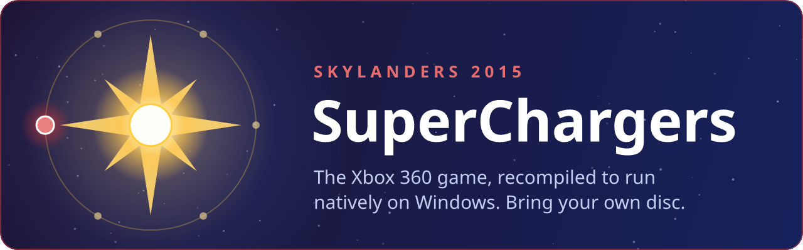
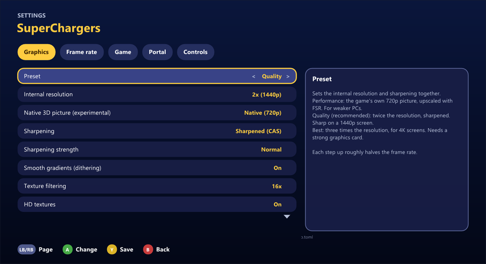

<a href="https://github.com/tsapZ/SkylandersCoreOfLight">Core of Light</a> (the launcher for all six) · <a href="#getting-started">Getting started</a> · <a href="#which-disc">Which disc</a> · <a href="#help">Help</a> · <a href="https://github.com/tsapZ/SuperChargersRecomp/issues/new/choose">Report a problem</a>

 

**Skylanders: SuperChargers** (Xbox 360, 2015) as a native Windows game: a controller, up to 3x the
console's resolution, 60 FPS, vehicles, no emulator. You bring your own copy of the game; nothing of
it comes with this project.

> Unofficial fan project. Not affiliated with or endorsed by Activision or Vicarious Visions.

## Getting started

**The easy way:** install [Core of Light](https://github.com/tsapZ/SkylandersCoreOfLight/releases)
and show it your disc. It downloads this game, sets it up and keeps it up to date, and does the same
for the other five games.

**On its own:**

1. Download `SuperChargersRecompSetup-<version>.exe` from the [Releases](https://github.com/tsapZ/SuperChargersRecomp/releases) page.
2. Run it and pick your disc, as an ISO file or an extracted folder. It checks the version and takes
   what it needs.
3. Start the game from the desktop or the Start menu.

What you need:

- Windows 10 or 11 (64-bit) and a graphics card with DirectX 12
- your own Xbox 360 disc of the game ([which one](#which-disc))
- a controller (Xbox or compatible); keyboard and mouse work too. A real Portal of Power is optional.

The setup isn't signed, so Windows may say "Windows protected your PC": click **More info**, then
**Run anyway**. No admin rights needed.

 

## What you get

- **A sharper picture:** 1x, 2x or 3x the console's 720p, AMD CAS sharpening and 16x texture
  filtering, with the presets *Performance*, *Quality* and *Best*. Bloom and motion blur can be
  turned down.
- **60 FPS**, or 30 as on the console, or 144 and more. The game keeps its normal speed.
- **Ultrawide:** a wider window shows more to the sides, and the HUD moves out to the edges.
- **No portal needed:** when the game asks for a Skylander, a menu with every figure and vehicle
  opens by itself, in the game's own look, with each vehicle's terrain. A real USB portal works
  too, or both at once.
- **A shorter Skylander intro** when a figure comes in, if you like (in the settings).
- **Your figures keep their progress** (level, gold, hats, upgrades) in files you can back up.
- **A settings menu** in the game: graphics, frame rate, language, portal, controls.
- **Achievements.**
- **A Discord status,** if you switch it on: the game, your Skylander and the level.
- **HD texture packs** work too ([how](https://github.com/tsapZ/SwapForceRecomp/blob/main/docs/texture-packs.md)).
- **Languages:** English and German from the En/De disc; Spanish and Italian from the Es/It one.

Its settings in Core of Light, the same pages as in the game's own menu (F4). The game's own pictures aren't shown here: they're Activision's.

 

## Controls

The game plays as it always did. On top of that:

| | Controller | Keyboard |
|---|---|---|
| Portal menu (put figures and vehicles on) | Guide, or Back + Start | F6 |
| Take figures off | Back + Y | F5 |
| Settings | Back + RB | F4 |
| Achievements | in the settings, under Game | F7 |
| Which controller plays which player | L3 + R3 | F9 |

The settings menu shows the keyboard keys for the game itself under Controls.

 

## How far it is

The portal tunnel ride, the first level and the ship (the game's hub) play. The driving levels
haven't been checked much yet, and nobody has played the whole game to the end. If something
breaks, please [tell me](https://github.com/tsapZ/SuperChargersRecomp/issues/new/choose).

What's being worked on: [docs/roadmap.md](docs/roadmap.md). Known bugs and the details:
[docs/STATUS.md](docs/STATUS.md).

 

## Help

**The setup says it's the wrong disc.** This port is made for the European discs (see
[Which disc](#which-disc)). If you have another one, open an issue with its name.

**It runs slowly.** Press F4, go to Graphics and pick *Performance*, or a lower internal resolution.

**Where are my saves and figures?** Saves in `Documents\Skylanders\SuperChargers`, figures in
`Documents\Skylanders\Figures` (shared by all six games). Core of Light can export all of it for a
new PC.

**Why are there no screenshots of the game?** They'd show its artwork, which belongs to Activision. The picture above is its settings page in Core of Light, the banner our own drawing.

## Which disc

Two European Xbox 360 discs work, the same build with other languages
([docs/game/discs.md](docs/game/discs.md)):

| Disc | Languages |
|---|---|
| Skylanders - SuperChargers (Europe) **(En,De)** | English and German, text and voices: the one to use |
| Skylanders - SuperChargers (Europe) (Es,It) | Spanish and Italian; English or German can be added (below) |

Other regions (USA and others) don't work yet: their executable is a different one.

### English or German on the Spanish / Italian disc

If you have the Es/It disc and also the En/De disc (or the PS3 disc), `tools/add_language.py` puts
the other disc's English or German text and voices into your extracted Es/It disc (`rom/`). The
game then runs in that language throughout, title screen and Xbox messages included.

    python tools/add_language.py --language en --xbox360 "D:\path\to\the En-De disc.iso" --voices
    python tools/add_language.py --language de --ps3 "D:\path\to\the PS3 disc.iso" [--voices]
    python tools/add_language.py --restore        (back to the disc's Spanish)

It needs Python 3, and extract-xiso (in `installer/`) for an Xbox 360 .iso or 7-Zip for a PS3
.iso; an extracted disc folder works as well. With the En/De disc none of this is needed.

## Reporting a problem

Open an [issue](https://github.com/tsapZ/SuperChargersRecomp/issues/new/choose) with the **Problem** form:
what you did and what happened. It helps a lot to attach the report from Core of Light (**LB**, the
launcher's settings, > **Report a problem**, or the question it asks after a crash). That's one text
file on your desktop with the latest logs and settings, your Windows user name taken out. Without
the launcher, the logs are in the `logs` folder next to the game's exe.

 

## Why this exists

I wanted to play the Xbox 360 Skylanders games on my PC with just a controller, no emulator, and
with a nicer picture. That's really all it is: a private fan project. It's public in case someone
else wants the same.

## How it was made

To be upfront about it: almost all of the code here was written by [Claude](https://claude.ai) in
Claude Code, the recompile setup, the fixes, the portal menu, the launcher and the installer, and
most of the docs too. I decided what to build, said what was broken and played the games a lot. If
AI-made projects aren't your thing, that's fair.

 

## For developers

The game's Xbox 360 code is recompiled to x86-64 with [ReXGlue](https://github.com/rexglue/rexglue-sdk)
(no CPU emulation); the graphics go through Xenia's D3D12 path. This repository holds only our own
code: the recompiled game code is made on your PC from your disc's `default.xex` when you build.

Building needs Windows, Visual Studio 2022 (C++ workload and C++ Clang tools), CMake, Ninja, just,
Git and Python 3, and the extracted disc in `rom/` ([rom/README.md](rom/README.md)). Steps:
[docs/development.md](docs/development.md), then `just play-release`. `just package-installer` builds
the setup. All docs: [docs/README.md](docs/README.md).

The banner and the button at the top are drawn by Core of Light's [`tools/make_banner.ps1`](https://github.com/tsapZ/SkylandersCoreOfLight/blob/main/tools/make_banner.ps1).

## Credits

- **[GiantsRecomp](https://github.com/tsapZ/GiantsRecomp)**, **[SSARecomp](https://github.com/tsapZ/SSARecomp)**
  and **[SwapForceRecomp](https://github.com/tsapZ/SwapForceRecomp)**: this project is scaffolded
  from them; app, portal, menus and tooling come from there.
- **[GiantsRecomp by TheBiemGamer](https://github.com/TheBiemGamer/GiantsRecomp)** brought
  Skylanders Giants to PC first and is the template these ports started from.
- **[ReXGlue](https://github.com/rexglue/rexglue-sdk)**, the static recompilation SDK, here in a
  fork with our fixes on top.
- **[skylanders-portal](https://github.com/TheBiemGamer/skylanders-portal)** by TheBiemGamer:
  the portal (software and USB), its overlay and the figure catalog, here in a fork with the
  shared portal and settings menus on top.
- Figure save-data decoding builds on public reverse-engineering of the Skylanders NFC format,
  among others **[SkyReader](https://github.com/reedstrm/SkyReader)**.
- **[extract-xiso](https://github.com/XboxDev/extract-xiso)** is included (prebuilt, unmodified)
  for the installer (`installer/extract-xiso.LICENSE.txt`).

Skylanders is a trademark of Activision. This project is not affiliated with or endorsed by
Activision.

## License

The code and documentation in this repository are released under the [MIT license](LICENSE). That
doesn't cover the game or its data, which you need to own and supply yourself, or the third-party
components in `thirdparty/`, which keep their own licenses.
